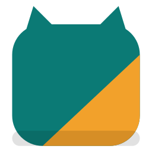

<p align="center"></p>

# TypoCat

[](https://github.com/hx-natthawat/typocat/actions/workflows/ci.yml)


A macOS menu-bar app that fixes words typed on the wrong keyboard layout
(`ghbdtn` → `привет`, `akuo` → `שלום`, `l;ylfu` → `สวัสดี`, `руддщ` → `hello`)
and switches the layout for you. It works with any layout macOS has; detection
needs a word list for the layout's language.

## Build and run

Requires macOS 13 or later and the Xcode command-line tools (full Xcode for `swift test`).

```bash
./scripts/build-app.sh           # fetches word lists, builds build/TypoCat.app
open build/TypoCat.app       # grant Accessibility access when asked
swift run TypoCat --selftest # detector checks against this Mac's real layouts
swift run TypoCat --eval 5000 # per-language fix rate, using every layout installed on this Mac
swift run TypoCat --eval-typos 5000 # typo correction: fix rate, wrong fixes, false changes
```

Enable the layouts you type with in System Settings → Keyboard → Input Sources.
TypoCat loads word lists only for the layouts you have enabled.

## Languages

Measured with `swift run TypoCat --eval 5000` on each language's 5000 most
frequent words, paired with English. "Fixed" is the share of words typed on the
wrong layout that get corrected; "changed" is the share of correctly typed words
that get changed by mistake.

| Language | Layout | Fixed (typed on EN) | EN fixed (typed on it) | Changed |
|---|---|---|---|---|
| Russian | Russian | 98.2% | 99.3% | 0.02% |
| Ukrainian | Ukrainian | 97.2% | 99.3% | 0.03% |
| Bulgarian | Bulgarian | 96.6% | 99.0% | 0.01% |
| Serbian | Serbian | 88.7% | 78.6% | 0.08% |
| Macedonian | Macedonian | 89.8% | 88.8% | 0.08% |
| Kazakh | Kazakh | 99.2% | 99.8% | 0.00% |
| Greek | Greek | 96.6% | 96.3% | 0.03% |
| Hebrew | Hebrew | 93.7% | 96.9% | 0.02% |
| Arabic | Arabic | 95.4% | 98.6% | 0.02% |
| Persian | Persian | 93.2% | 98.7% | 0.07% |
| Urdu | Urdu | 87.7% | 97.5% | 0.11% |
| Armenian | Armenian HM QWERTY | 91.1% | 98.4% | 0.04% |
| Georgian | Georgian QWERTY | 93.4% | 98.1% | 0.01% |
| Hindi | Devanagari | 92.7% | 99.0% | 0.10% |
| Thai | Thai | 96.0% | 99.0% | 0.02% |

Most misses are two-letter words that are real words in both languages
(`да`/`lf`, `το`/`to`). Serbian and Macedonian layouts are phonetic, so many
English words are also valid Cyrillic words. The Serbian list is mostly Latin
script and is transliterated to Cyrillic on load. Greek accents are typed with
dead keys, which are supported. Thai (and other scripts without spaces) also
rereads short words once a later word is fixed: 82% of missed short Thai words
are recovered.

Adding a language: add its code to `Language.bundled` and to the list in
`scripts/build-app.sh`, run `--eval`, and add a few words to `SelfTest`.
Layouts that are input methods (Japanese, Chinese, Korean) have no key map and
aren't supported.

The build is ad-hoc signed by default, so macOS drops Accessibility access
after each rebuild. To keep it, sign with a stable certificate:
`SIGN_IDENTITY="Your Cert Name" ./scripts/build-app.sh`. If corrections stop, remove TypoCat from
System Settings → Privacy & Security → Accessibility and add it again.

## Using it

- **Fixing a word:** type it on the wrong layout and press Space, Return or Tab. The word is retyped on the right layout, and the keyboard switches to that layout.
- **Undo:** press Backspace or ⌘Z right after a fix. TypoCat won't fix that word again.
- **Convert now:** press ⌃⌥Space to convert the current word whatever the detector thinks.
- **Menu options:**
  - **Disable in \<App\>:** turns TypoCat off for the front app.
  - **Match layout to each app:** switching to an app selects the language you usually type there. This starts after 20 words and needs a 75% majority.
  - **Fix typos (beta):** off by default. See below.
  - **Open at login.**
- **Never converted:** tech names (`git`, `api`, `json`…). In terminals and code editors, shell commands are not converted either.
- **Field check:** before rewriting, TypoCat reads the focused field through the Accessibility API and checks that it ends with the typed word. If it doesn't (autocomplete, a moved cursor), the fix is skipped. Apps that don't expose their text fall back to the keystroke buffer.

## Typo correction (beta)

With "Fix typos" on, a lowercase word of four or more letters that isn't in
the word list is replaced by the most common word one edit away (a missing,
extra, swapped or wrong letter). It only happens when that word is at least
10× as common as the next candidate and macOS's spell checker flags the typo
and suggests the same word first. Never in terminals or code editors, never
for capitalized words, and never for Thai and other scripts without spaces.
Undo works the same way as for layout fixes.

Measured with `--eval-typos 5000` (one random edit in each common word; "rare
correct words" are real words ranked 40001+ that a list cut at 40000 doesn't know):

| Language | Typos fixed | Fixed to the wrong word | Rare correct words changed |
|---|---|---|---|
| English | 19.8% | 2.0% | 1.9% |
| Russian | 18.4% | 0.2% | 0.5% |

Other languages stay off: on the test Mac, macOS lists Ukrainian, Bulgarian,
Greek, Hebrew and Arabic spelling but flags nothing, and has no Serbian,
Macedonian, Persian or Georgian dictionary. Many "rare words" it still changes
are subtitle noise (`havea`, `nello`), so the real false-change rate is lower.

## How it works

1. A `CGEventTap` records each key press as a physical key code plus Shift, not as a character.
2. When a word ends, the key presses are re-rendered on every enabled layout. The layouts are read with `TISCopyInputSourceForLanguage` and `UCKeyTranslate`.
3. Each rendering is scored by how common it is in that language's word list, using its rank so languages with small corpora compare fairly. Scripts written without spaces (Thai, Lao, Khmer, Burmese) are scored by how much of the text splits into dictionary words; Thai also rejects impossible vowel and tone-mark orders.
4. If the typed text isn't a word and another rendering is a confident one, the word is erased with Backspace and retyped as Unicode. Then the layout is switched with `TISSelectInputSource`.

Code layout:

| Path | What's in it |
|---|---|
| `Sources/TypoCatCore` | Platform-free logic: layout maps, dictionaries, scoring, app categories, per-app language counts |
| `Sources/TypoCat` | The app: event tap, input sources, Accessibility checks, menu, settings |

Local data lives in `~/Library/Application Support/TypoCat/`:
`ignoredWords.json` (words you undid) and `appLanguageCounts.json`.

## Footprint

A native Swift app (no Electron, no web view): a 0.5 MB binary plus about
11 MB of word lists. Word lists load in the background at launch and only for
enabled layouts. Measured with `swift run -c release TypoCat --bench en th`:

| Layouts enabled | Load time (background) | Memory (Activity Monitor) |
|---|---|---|
| English only | 0.1 s | 16 MB |
| English + Russian | 0.4 s | 28 MB |
| English + Thai | 0.9 s | 39 MB |
| 7 languages | 3.2 s | 59 MB |

When idle it uses no CPU: it reacts only to key presses. Electron apps (VS Code,
Slack, Discord) are asked to expose their text fields to Accessibility so the
field check works there too. That works in VS Code; where an app still hides its
fields, TypoCat falls back to its keystroke buffer.

## Privacy

Everything runs on your Mac. TypoCat keeps only the current word in memory.
It does not log or send keystrokes, and it pauses in secure input fields such as
password boxes.

## Roadmap

- Use the surrounding words to settle ambiguous short words (`so`/`หน`, `ok`/`นา`).
- Detect Thai mid-phrase, before a space is typed.
- Learn the user's own vocabulary.
- Remember the language per website in browsers.
- Latin-to-Latin layouts (AZERTY, QWERTZ, Dvorak), where wrong-layout text still looks like letters.

## Contributing

See [CONTRIBUTING.md](CONTRIBUTING.md): setup, how to measure a detection
change, and how to add a language. Privacy details are in [SECURITY.md](SECURITY.md).

## Credits and license

The code is MIT-licensed; see [LICENSE](LICENSE).

The word lists are not part of this repository. `scripts/build-app.sh`
downloads them from [hermitdave/FrequencyWords](https://github.com/hermitdave/FrequencyWords),
whose content is licensed CC BY-SA 4.0. If you redistribute a built app, include
that attribution.
